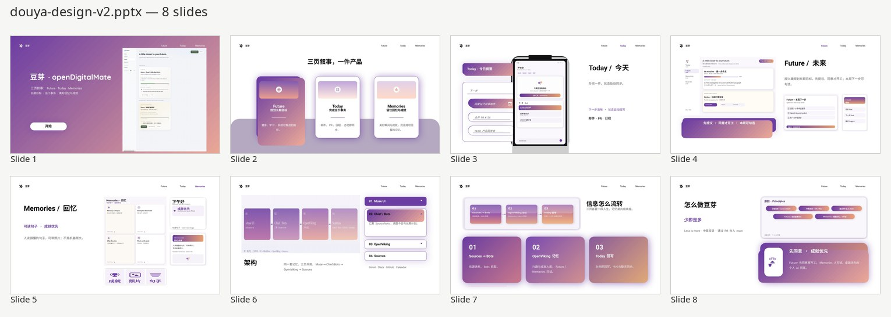

# openDigitalMate

### Douya / 豆芽 — a Muse-style coworker for your desktop

[]
[](#run-from-source)
[](https://github.com/deepseek-ai/dsh)
[](#language)

<p align="center">
  
</p>

One product. Three pages. Shared memory underneath.

| **Future** | **Today** | **Memories** |
| --- | --- | --- |
| Long-term plans grown from your interests — fitness, study, craft. Propose first; **consent before work**. | Current affairs from mail, PRs, Slack, calendar. Finish something and the state writes back everywhere. | Readable memories & achievements — human sentences, photos welcome. Achievements surface first. |

Douya is a **desktop-first** Electron app for **Windows, macOS, and Linux**. The UI is bilingual EN / 中文. Mobile apps were cancelled. It is not a fully offline product: chat and many features need a supported model provider, and sources need [Composio](https://app.composio.dev) plus your consent for anything outbound.

```
  Muse UI  ──▶  Chief / source bots  ──▶  OpenViking  ──▶  Sources
  (Today ·     (merge, rank,          (shared            (Gmail · Slack ·
   Memories ·   plan, chat)            memory)             GitHub · Calendar)
   Future)
```

Less is more · ship via PR into `main` (never push `main` directly).

**Repo:** [open-x-agents/openDigitalMate](https://github.com/open-x-agents/openDigitalMate) · the root and desktop `package.json` files list `license` as `Apache-2.0`

---

## Download the desktop app

Current desktop packages: **[desktop-v0.1.0-rc7](https://github.com/open-x-agents/openDigitalMate/releases/tag/desktop-v0.1.0-rc7)** (prerelease, built from `92d751b0`).

Do **not** use [github.com/open-x-agents/openDigitalMate/releases/latest](https://github.com/open-x-agents/openDigitalMate/releases/latest) for the app. That “latest” badge is **[v0.1.0](https://github.com/open-x-agents/openDigitalMate/releases/tag/v0.1.0)** (2026-10-30), an earlier stable source/tag release **without** these installers.

| Platform | File |
| --- | --- |
| Windows x64 | [Douya-0.1.0-win-x64-Setup.exe](https://github.com/open-x-agents/openDigitalMate/releases/download/desktop-v0.1.0-rc7/Douya-0.1.0-win-x64-Setup.exe) · [self-signed .cer](https://github.com/open-x-agents/openDigitalMate/releases/download/desktop-v0.1.0-rc7/Douya-0.1.0-win-x64-selfsigned.cer) (public cert only) |
| macOS Apple Silicon | [Douya-0.1.0-mac-arm64.dmg](https://github.com/open-x-agents/openDigitalMate/releases/download/desktop-v0.1.0-rc7/Douya-0.1.0-mac-arm64.dmg) |
| macOS Intel | [Douya-0.1.0-mac-x64.dmg](https://github.com/open-x-agents/openDigitalMate/releases/download/desktop-v0.1.0-rc7/Douya-0.1.0-mac-x64.dmg) |
| Linux x64 | [AppImage](https://github.com/open-x-agents/openDigitalMate/releases/download/desktop-v0.1.0-rc7/Douya-0.1.0-linux-x64.AppImage) or [`.deb`](https://github.com/open-x-agents/openDigitalMate/releases/download/desktop-v0.1.0-rc7/douya-desktop_0.1.0_amd64.deb) |
| Linux arm64 | [AppImage](https://github.com/open-x-agents/openDigitalMate/releases/download/desktop-v0.1.0-rc7/Douya-0.1.0-linux-arm64.AppImage) or [`.deb`](https://github.com/open-x-agents/openDigitalMate/releases/download/desktop-v0.1.0-rc7/douya-desktop_0.1.0_arm64.deb) |

Checksums: [SHA256SUMS](https://github.com/open-x-agents/openDigitalMate/releases/download/desktop-v0.1.0-rc7/SHA256SUMS).

On Linux pick **one** format, not both: `.deb` on Ubuntu/Debian, AppImage on other distributions. Match your CPU (x64 vs arm64). The AppImage needs `libfuse.so.2` to run in place (`chmod +x` first); if FUSE is missing, use `--appimage-extract-and-run`. Do not pass `--no-sandbox`.

Installers are not warning-free. macOS is ad-hoc signed and **not notarized** (right-click **Douya.app → Open**, or `xattr -dr com.apple.quarantine /Applications/Douya.app`). Windows is **self-signed** (SmartScreen: More info → Run anyway). Linux packages are **unsigned**.

The installer is a shell, not a self-contained server. It always needs a checkout of this repo (a folder that contains `scripts/start-dsh.mjs`; the app looks in the usual places or asks once). If nothing already answers on `127.0.0.1:7777` with a working token, it starts that script from the checkout and therefore needs **[dsh](https://github.com/deepseek-ai/dsh)** (`$DSH_BIN`, then `~/Documents/git/dsh-rc5/bin/dsh`, then `dsh` on `PATH`). A separate Node.js install is not required: the app prefers `node` on `PATH`, otherwise it runs the start script with Electron’s bundled Node.

Installers bundle OpenViking **0.5.4**, relocatable CPython, `llama-cpp-python`, and the local `bge-small-zh-v1.5-f16` embedding GGUF (Chinese-optimized; English is weaker). Semantic auto-recall can work **without a cloud key or Ollama**. A VLM / chat model is **not** shipped — chat still needs a supported provider, and memory extraction and summaries need a VLM. The app does not rebuild existing vectors, and it does not move an existing OpenViking workspace for you. Details: [docs/install.md](docs/install.md), [docs/memory.md](docs/memory.md).

This rc also includes the long-running chat wait: if Chief is still working, the UI keeps waiting instead of reporting no reply after a few minutes. A turn that stays marked running can keep you waiting; hangs are not all detected.

---

## Run from source

```bash
npm install
npm start
# → node scripts/start-dsh.mjs → dsh --profile odm --port 7777
```

The process writes a login URL (with token) to `.odm-data/dsh-web.url`. **Open that token URL** — bare `http://127.0.0.1:7777` returns 401.

```bash
open "$(cat .odm-data/dsh-web.url)"          # macOS
# xdg-open "$(cat .odm-data/dsh-web.url)"   # Linux
```

> Do not commit or paste the token URL into issues or chat logs.

On macOS you can put that behind a system-wide hotkey — see [docs/mac-shortcut.md](docs/mac-shortcut.md).

### Configure AI + Composio

1. **Settings** → pick a provider (e.g. DeepSeek), paste the key, Save
2. Paste a **Composio** key, Save, then connect GitHub / Gmail / Slack / Calendar (and only the apps you want)
3. **Today** → **Refresh now**

Outbound mail, comments, and archives stay pending until you click **Confirm**. Keys also work from `.env` (`DEEPSEEK_API_KEY` / `COMPOSIO_API_KEY`) or `.odm-data/config.json` (gitignored). DeepSeek needs a real key — an OpenAI-only setup makes Chief say “No model is available”. Source checkout and packing the app: [docs/develop.md](docs/develop.md). Model details: [docs/LLM_SETUP.md](docs/LLM_SETUP.md).

### Language

Default UI is **English**. Switch to 中文 in Settings or the sidebar (`localStorage` key `odm.lang`). Digest card *bodies* stay as the bots wrote them.

---

## Memory in brief

Douya uses **[OpenViking](https://docs.openviking.net/en/agent-integrations/17-dsh)** via [`@openviking/dsh-memory-plugin`](https://www.npmjs.com/package/@openviking/dsh-memory-plugin) (~0.5.33). Chat auto-recall, the Memories / Recall page, and Future’s grounding share `viking://~/memories`.

Desktop installers already include the server and the local GGUF; a new app-local `ov.conf` points at the shipped file, and `~/.openviking/ovcli.conf` is created only if it is missing. An existing `~/.openviking/ov.conf` is left alone. The app does not rebuild existing vectors. For `npm start`, you run or reuse a server on `127.0.0.1:1933` yourself — see [docs/memory.md](docs/memory.md).

---

## What you can do here

| Surface | What it actually does |
| --- | --- |
| **Today** | Hero, timetable, digest cards, prepared next steps, “what got done” |
| **Future / 未来** | Propose a plan from a memory or a stated interest; accept before work; tick or complete a step (including **Do this with Douya**); archive. Progress lives in host `state.json` and survives a restart |
| **Memories / Recall** | Readable tiles + photos (≤ 5 MB), achievements first; forget removes the memory and its photos |
| **Sources** | Connect apps via Composio. Coverage and limits: [docs/sources/connected-scans.md](docs/sources/connected-scans.md) |
| **Dock chat** | Talk with Chief. Confirmed sends can echo into card chat and general chat |

Local-only: the UI binds to `127.0.0.1`.

---

## Docs

[Index](docs/README.md) · [Install & data](docs/install.md) · [Memory](docs/memory.md) · [Develop](docs/develop.md) · [Testing](docs/testing.md) · [Architecture](docs/architecture.md) · [Design](docs/design/README.md)

---

## Security

- **Localhost only** — other machines cannot open the UI
- Never commit `.env`, `.odm-data/`, or the token URL file
- Outbound actions require an explicit Confirm click

## Contributing

1. Branch from `main` — never push directly to `main`
2. Keep tests green: `npm test`
3. Open a PR with `Fixes #N`, a `Ran:` section, and the tip sha
4. Merge only when the owner says so

## License

The root and desktop `package.json` files list `license` as `Apache-2.0`. This tree does not add a separate license grant file. Bundled runtimes keep their upstream terms: OpenViking is AGPL-3.0; the shipped embedding GGUF and `llama-cpp-python` are MIT. See [docs/install.md](docs/install.md).
