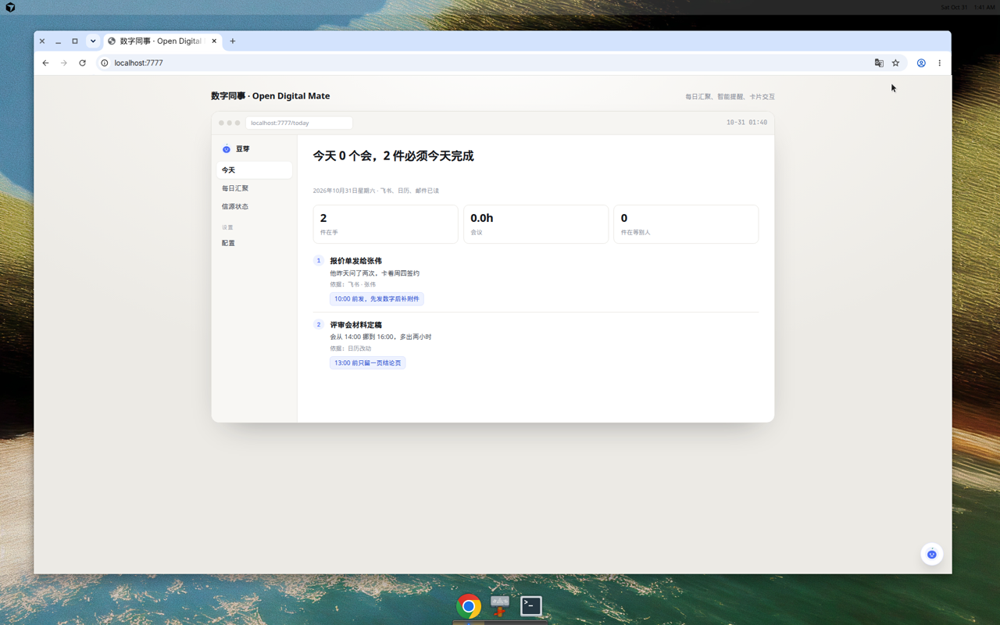
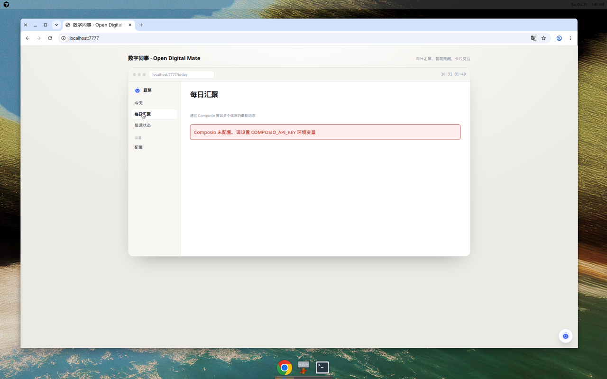

# opendigitalmate

飞书里的数字同事，基于 **ds-bot**（`Fei2411/DeepSeek-Bot` 的 DSH 插件）开发：接日报、盯日程、卡片可点，配一个面板。

**✨ v0.2.0 新功能：**
- 🎨 全新卡片式交互界面
- 🔌 Composio 多源信息聚合
- 📊 每日汇聚推送
- 🌐 独立 Web 服务器

---

## 快速开始

### 1. 安装依赖

```bash
npm install
# 或
pnpm install
```

### 2. 配置环境变量

复制 `.env.example` 到 `.env` 并填写配置：

```bash
cp .env.example .env
```

**必需配置（Composio 集成）：**
- `COMPOSIO_API_KEY` - 从 [Composio](https://app.composio.dev) 获取 API 密钥

**可选配置：**
- `COMPOSIO_ENTITY_ID` - 实体 ID（默认：'default'）
- `DIGEST_SCHEDULE` - 每日推送时间（默认：08:00）
- `PORT` - 服务器端口（默认：7777）

### 3. 启动服务

#### 方式一：独立 Web 服务器（推荐）

```bash
node scripts/server.js
```

然后访问 http://localhost:7777

#### 方式二：作为 DSH 插件运行

```yaml
# cordis 配置中添加
- insert:
    - id: opendigitalmate
      name: opendigitalmate
      config:
        composioApiKey: $COMPOSIO_API_KEY
```

---

## 功能特性

### 🎨 卡片式界面

全新设计的 Web UI，最小化文字展示，通过结构化卡片呈现信息：

- **今天视图** - 当天任务、会议、待办
- **每日汇聚** - Composio 聚合的多源信息
- **信源状态** - 查看已连接的数据源
- **实时交互** - 聊天式对话面板

### 🔌 Composio 集成

通过 Composio 连接 1000+ 应用，自动聚合信息：

**支持的应用包括：**
- GitHub - 代码仓库、PR、Issue
- Slack - 团队消息、频道
- Gmail - 邮件收发
- Linear - 项目管理、任务
- Google Calendar - 日历事件
- Notion - 知识库、文档
- 更多...

**设置步骤：**

1. 注册 [Composio](https://app.composio.dev) 账号
2. 获取 API 密钥
3. 在 `.env` 中配置 `COMPOSIO_API_KEY`
4. 通过 Composio 面板连接你的应用账号
5. 重启服务，查看"每日汇聚"标签页

### 📊 每日汇聚推送

每天定时（默认 08:00）自动聚合多个信源的最新动态：

- 未读通知和消息
- 待处理的任务
- 即将到来的日程
- 重要邮件摘要

配置推送时间：
```bash
DIGEST_SCHEDULE=08:00  # 24小时格式 HH:MM
```

### 🤖 聊天交互

右下角常驻聊天面板，随时与数字同事对话：
- 查询任务详情
- 了解信源状态
- 询问依据来源
- 操作日程安排

---

## 原有功能（v0.1.0）

| 能力 | 状态 | 在哪里 |
| --- | --- | --- |
| 飞书接入 | 复用 ds-bot 的长连接通道 | `src/host/feishu.js` |
| 日报 | 按成员汇总当天日程、已完成、明天计划，组装成飞书交互卡片 | `src/host/report.js`、`src/host/cards.js` |
| 日程提醒 | 从日历事件算出「会议前 N 分钟」，到点推送，失败重试 | `src/host/reminders.js`、`index.js` 的 `tick()` |
| 可交互 | 卡片按钮回调：推迟 10 分钟 / 已完成 / 改时间 / 补充日报 | `src/host/cards.js`、`index.js` 的 `onCardAction()` |
| 面板 | 单页：提交率、还没交的人、近期日程、投递记录 | `src/client/panel.html`、`src/host/panel.js` |

---

## 开发与测试

### 运行测试

```bash
node --test test/*.test.js     # 全部测试
```

36 个单元测试全绿，覆盖日报组装、提醒规划、卡片结构、按钮解析、面板快照、存储和插件接线。

### 演示

```bash
node scripts/demo.mjs          # 打印一张日报卡和一张提醒卡（不发出去）
```

---

## API 端点

### Web UI
- `GET /` - 主界面

### REST API
- `GET /api/today` - 今天的摘要和任务
- `GET /api/digest` - Composio 每日汇聚
- `GET /api/sources` - 信源连接状态
- `GET /api/config/check` - 配置检查

---

## 目录结构

```
.
├── index.js                    # 插件入口与运行时
├── scripts/
│   ├── server.js              # 独立 Web 服务器
│   └── demo.mjs               # 演示脚本
├── src/
│   ├── host/                  # 核心逻辑（纯函数）
│   │   ├── api.js            # 🆕 API 路由
│   │   ├── composio.js       # 🆕 Composio 集成
│   │   ├── report.js         # 日报生成
│   │   ├── reminders.js      # 提醒计划
│   │   ├── cards.js          # 飞书卡片
│   │   ├── panel.js          # 面板数据
│   │   ├── store.js          # 持久化存储
│   │   ├── feishu.js         # 飞书发送
│   │   ├── buffer.js         # 消息聚合
│   │   └── threads.js        # 话题识别
│   └── client/
│       ├── index.html        # 🆕 主界面
│       └── panel.html        # 原面板（兼容）
├── test/                      # 单元测试
├── docs/                      # 架构文档
└── .env.example              # 环境变量模板
```

---

## 两个刻意的设计

**提醒的 key 是「事件 + 到点时刻」**，不是事件 id。所以「推迟 10 分钟」是一次新的投递，而不是把已经发过的标记改掉；原提醒不被修改。

**晚到的 tick 也要发**。会议还没开始时，即使提醒的预定时刻已经过去，也立刻发出去——漏掉一分钟不该等于漏掉这场会。

---

## 配置选项

### 作为插件使用

```javascript
{
  credentials: () => ({ appId, appSecret }),  // 飞书应用凭证
  calendar: async () => events[],             // 日历数据源
  sendCard: async ({ receiveId, card }) => messageId,  // 覆盖发送方法
  ownerOpenId: 'ou_xxx',                      // 无主提醒的接收人
  leadMinutes: 10,                            // 提前几分钟提醒
  composioApiKey: 'xxx',                      // Composio API 密钥
  composioEntityId: 'default',                // 实体 ID
  digestSchedule: '08:00',                    // 推送时间
  enableDigest: true,                         // 启用每日汇聚
}
```

---

## 安全说明

⚠️ **永远不要提交包含真实密钥的 `.env` 文件！**

`.env` 已添加到 `.gitignore`。所有敏感信息应通过环境变量注入：

```bash
# 本地开发
cp .env.example .env
# 编辑 .env，填入真实密钥

# 生产环境
export COMPOSIO_API_KEY=your_real_key
node scripts/server.js
```

---

## 截图

### 主界面 - 今天视图


### 每日汇聚 - Composio 集成


### 聊天交互


---

## 还需要做

- [ ] 飞书应用的完整 OAuth 流程
- [ ] 日历数据源接入飞书 API
- [ ] 日报收集的表单卡片流
- [ ] Composio 连接管理界面
- [ ] 每日汇聚的推送渠道配置
- [ ] Docker 容器化部署
- [ ] 更多信源适配器

---

## 许可证

Apache-2.0

---

## 贡献

欢迎提交 Issue 和 Pull Request！

开发指南：
1. Fork 本仓库
2. 创建特性分支：`git checkout -b feature/amazing-feature`
3. 提交更改：`git commit -m 'Add amazing feature'`
4. 推送分支：`git push origin feature/amazing-feature`
5. 提交 Pull Request

确保所有测试通过：`node --test test/*.test.js`

---

## 支持

- 📖 [架构文档](docs/architecture.md)
- 🐛 [报告问题](../../issues)
- 💬 [讨论区](../../discussions)
