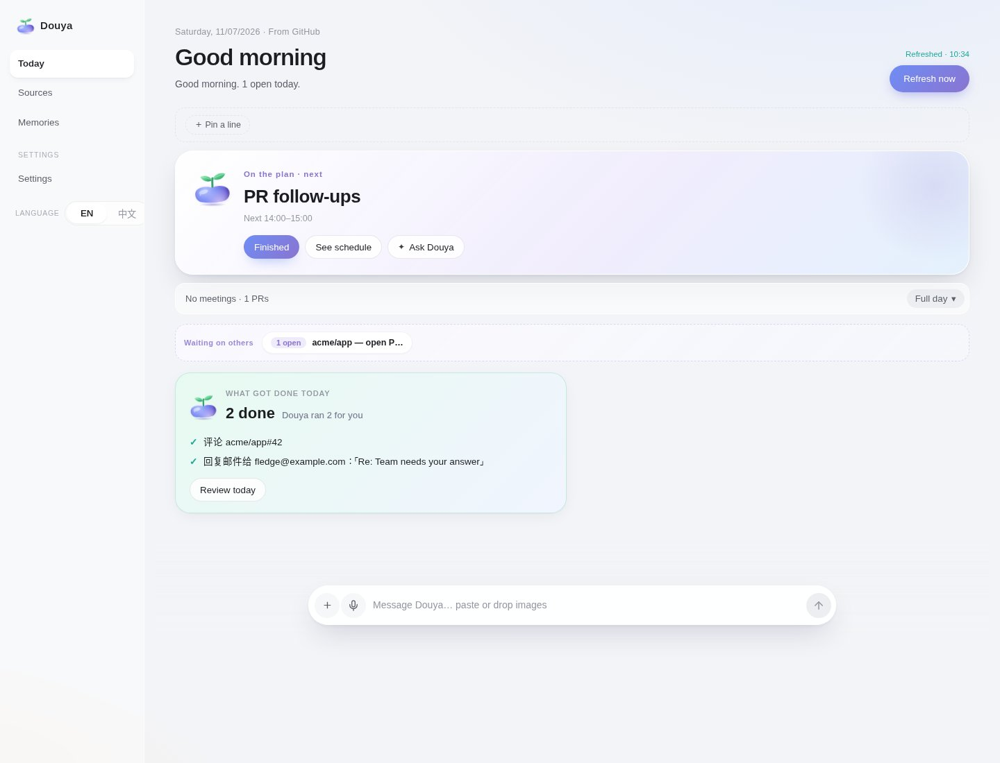

# Douya

<p align="center">
  
</p>

**Douya / 豆芽** is a desktop personal assistant for Windows, macOS, and Linux.

[Website](https://open-x-agents.github.io/Douya/) · [Interactive demo](https://open-x-agents.github.io/Douya/#demo) · [Download](https://github.com/open-x-agents/Douya/releases/latest) · [Docs](docs/README.md)

<p align="center">
  <a href="https://open-x-agents.github.io/Douya/#demo">
    
  </a>
</p>

<p align="center">
  This is Today in the app. <a href="https://open-x-agents.github.io/Douya/#demo">Try the interactive demo</a> on the website — click through Today, Chat, Recall, and Future.
</p>

It sits on your desktop and brings today’s mail, GitHub, Slack, and calendar onto one page. You can talk to it, keep a local memory, and grow longer-term plans — with your consent before anything goes outbound.

The UI is bilingual, English and 中文. Chat needs a model key and a network connection. Connecting Gmail, GitHub, Slack, or calendar is optional and uses [Composio](https://app.composio.dev).

## Core features

Here’s what Douya does. Each item has a matching walkthrough on the [interactive demo](https://open-x-agents.github.io/Douya/#demo).

| | Feature | What it does |
| --- | --- | --- |
|  | **Today** | Today’s mail, GitHub, Slack, and calendar on one page. Sources that couldn’t be fetched are listed clearly. |
|  | **My Day timetable** | What’s next, what’s already done, and what’s coming. |
|  | **Chat, confirm before sending** | Talk with Douya from the dock or a card. Outbound mail, comments, and similar wait until you click Confirm. |
|  | **Recall** | Readable memories kept on this computer. Achievements come first. |
|  | **Future plans** | Long-term plans you accept first, then advance in chat — or tick a step yourself. |

## Download

Current desktop packages: **[desktop-v0.1.0](https://github.com/open-x-agents/Douya/releases/tag/desktop-v0.1.0)** ([Latest](https://github.com/open-x-agents/Douya/releases/latest)). Checksums: [SHA256SUMS](https://github.com/open-x-agents/Douya/releases/download/desktop-v0.1.0/SHA256SUMS).

| Platform | File |
| --- | --- |
| Windows x64 | [Douya-0.1.0-win-x64-Setup.exe](https://github.com/open-x-agents/Douya/releases/download/desktop-v0.1.0/Douya-0.1.0-win-x64-Setup.exe) · [self-signed .cer](https://github.com/open-x-agents/Douya/releases/download/desktop-v0.1.0/Douya-0.1.0-win-x64-selfsigned.cer) (public cert only) |
| macOS Apple Silicon | [Douya-0.1.0-mac-arm64.dmg](https://github.com/open-x-agents/Douya/releases/download/desktop-v0.1.0/Douya-0.1.0-mac-arm64.dmg) |
| macOS Intel | [Douya-0.1.0-mac-x64.dmg](https://github.com/open-x-agents/Douya/releases/download/desktop-v0.1.0/Douya-0.1.0-mac-x64.dmg) |
| Linux x64 | [AppImage](https://github.com/open-x-agents/Douya/releases/download/desktop-v0.1.0/Douya-0.1.0-linux-x64.AppImage) or [`.deb`](https://github.com/open-x-agents/Douya/releases/download/desktop-v0.1.0/douya-desktop_0.1.0_amd64.deb) |
| Linux arm64 | [AppImage](https://github.com/open-x-agents/Douya/releases/download/desktop-v0.1.0/Douya-0.1.0-linux-arm64.AppImage) or [`.deb`](https://github.com/open-x-agents/Douya/releases/download/desktop-v0.1.0/douya-desktop_0.1.0_arm64.deb) |

Download, install, and open Douya. The first time you launch it, a short setup asks for your model key.

Installers are not warning-free. macOS is ad-hoc signed and not notarized (right-click **Douya.app → Open**, or `xattr -dr com.apple.quarantine /Applications/Douya.app`). Windows is self-signed (SmartScreen: More info → Run anyway). Linux packages are unsigned. On Linux pick **one** format: `.deb` on Ubuntu/Debian, AppImage elsewhere. Details: [docs/install.md](docs/install.md).

## First launch

The first time you open Douya, it asks you to set a few things (you can also change them later in Settings):

1. **Add your model key** — pick a provider (DeepSeek is the default), enter your key, and save. Chat needs this.
2. **Connect your apps** (optional, can skip) — bring in the mail, calendar, GitHub, or Slack you already use. You can do this later.

Outbound mail, comments, and archives stay pending until you click **Confirm**.

More: [docs/memory.md](docs/memory.md), [docs/sources/connected-scans.md](docs/sources/connected-scans.md), [docs/LLM_SETUP.md](docs/LLM_SETUP.md).

## Privacy

Your mail, memory, and plans stay on this computer, in the app’s folder — on macOS `~/Library/Application Support/Douya`, on Windows `%APPDATA%\Douya`, on Linux `~/.config/Douya`. Nothing is written into the install folder.

Chat still uses the model you choose. Connected apps go through [Composio](https://app.composio.dev) only after you agree. Chat and those apps need a network connection.

## Develop

```bash
npm install
npm start
# → node scripts/start-dsh.mjs → dsh --profile odm --port 7777
```

The process writes a login URL (with token) to `.odm-data/dsh-web.url`. Open that token URL — bare `http://127.0.0.1:7777` returns 401.

> Do not commit or paste the token URL.
>
> On macOS you can put that behind a system-wide hotkey — see [docs/mac-shortcut.md](docs/mac-shortcut.md).

```bash
open "$(cat .odm-data/dsh-web.url)"          # macOS
# xdg-open "$(cat .odm-data/dsh-web.url)"   # Linux
```

`npm test` runs the suite. Branch from `main`, keep tests green, and open a PR (`Fixes #N`, a `Ran:` section, the tip sha). Never push `main` directly. Further notes: [docs/develop.md](docs/develop.md), [docs/testing.md](docs/testing.md), [docs/architecture.md](docs/architecture.md).

## License

The root and desktop `package.json` files list `license` as `Apache-2.0`. This tree does not add a separate license grant file. Bundled runtimes keep their upstream terms: `@modelcontextprotocol/server-memory` is MIT. Repo: [open-x-agents/Douya](https://github.com/open-x-agents/Douya).
