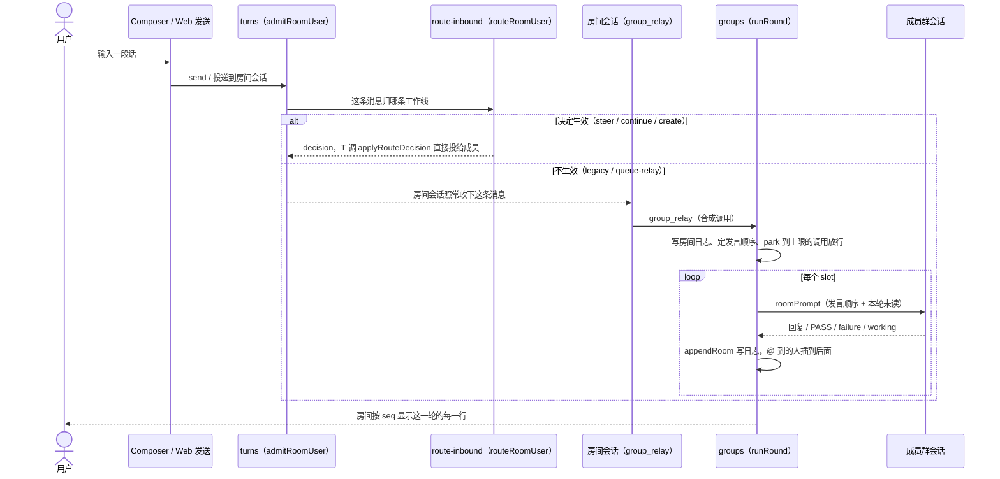
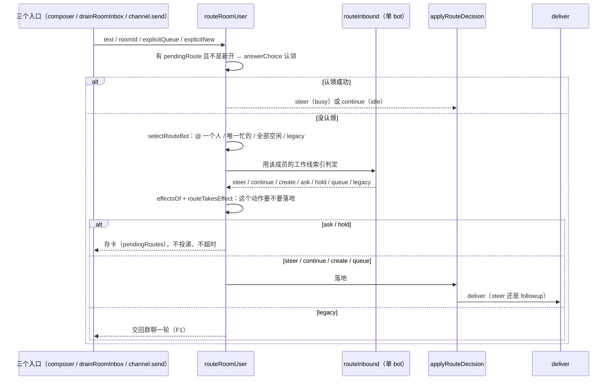

# 群聊与工作线：现状实现说明

> 基线：`dev_nyp @ 6cbb5cc`（本机实跑 231 条全绿）；对照：`main @ 33d7de2`（差值见 §7.1）。
> 核对：2026-10-31。写的是**代码现在怎么跑**，不是计划；引用与行号以基线 sha 为准。
> 本文只覆盖 PR1 的 §1–§4（F1、F2）与 §7；§5 停止·迟到·inbox、§6 Web 与桌面由 PR2 补齐。

## 1. 目的与原则

群聊和工作线不是两套会话系统，而是同一批 DSH 会话的两种用法：一条工作线指向一条**已经存在**的会话，一个群聊则是「房间日志 + 每成员一条隐藏群会话 + 一次只让一个人说」的调度器。以下六条是代码里真正生效的约束，读的时候可以拿它们验证任何一段实现。

1. **一条工作线 = 一条已有会话。** 索引只存元数据，`INDEX_FIELDS` — `vendor/ds-bot/src/host/work-lines.js:10` 是一份白名单；`indexOnly` — `vendor/ds-bot/src/host/work-lines.js:62` 只接受这 9 个键。`createLine` — `vendor/ds-bot/src/host/work-lines.js:105` 明确丢掉 `messages` / `memory` / `status` 这类正文，正文永远在会话日志里，`state.json` 不存消息。
2. **房间只投递，不搬记录。** 一条消息进入房间只写这一次（`appendRoom` — `vendor/ds-bot/src/host/groups.js:192`），跨房间继续也不会把源房间的 transcript 抄进目标房间：`deliverAcrossRooms` — `vendor/ds-bot/src/host/route-inbound.js:595` 只更新索引的房间指针，回复由 `armArrivalReply` — `vendor/ds-bot/src/host/route-inbound.js:572` 用 `projectExchange` — `vendor/ds-bot/src/host/work-lines.js:223` 投影成「这一问一答」两行。
3. **busy 不落盘，是活的状态。** `isBusy` — `vendor/ds-bot/src/host/work-lines.js:71` 读 `live.turn`；进程退出、重启后 busy 自然变回空闲，不会在 `state.json` 里留下「正在工作」的错觉。
4. **一个决定，三个入口共用。** 输入框、一轮中的收件箱、Web/桌面的发送接口都走同一套判定：`admitRoomUser` — `vendor/ds-bot/src/host/turns.js:384`（composer）、`drainRoomInbox` — `vendor/ds-bot/src/host/groups.js:602`（进行中的一轮）、`send` — `vendor/ds-bot/src/host/channel.js:446`（Web/桌面），三者都调用 `routeRoomUser` — `vendor/ds-bot/src/host/route-inbound.js:461`。决定能写什么由 `effectsOf` — `vendor/ds-bot/src/host/route-inbound.js:265` 说清，是否落地由 `routeTakesEffect` — `vendor/ds-bot/src/host/route-inbound.js:288` 判定。
5. **低置信先问，不猜。** 命中多条、或命中与「不确定」混在一起时，`routeInbound` — `vendor/ds-bot/src/host/route-inbound.js:201` 返回 `ask`，卡片存进 `pendingTable` — `vendor/ds-bot/src/host/route-inbound.js:351`，`timeoutSends` — `vendor/ds-bot/src/host/route-inbound.js:705` 是 `false`：等用户点，不会超时替用户发出。卡片形状由 `routeCard` — `vendor/ds-bot/src/host/route-inbound.js:251` 定义。
6. **群聊按轮说话，Bot 之间互相 @ 有上限。** 一轮一个人，发言顺序写进每个成员的 prompt（`roomPrompt` — `vendor/ds-bot/src/host/groups.js:241`）；Bot 互调计数到 `defaultRelayLimit` — `vendor/ds-bot/src/host/groups.js:44`（3 × 成员数）就 park 到 `room.paused`，**不丢**，用户说话或 Continue（`continueRoom` — `vendor/ds-bot/src/host/groups.js:1301`）放行。
7. **Stop 只丢 relay，不丢用户消息。** Stop 打断房间会话后，已经落进房间日志的 relay 从 inbox 移除（`dropLoggedRelays` — `vendor/ds-bot/src/host/room-halt.js:22`），用户自己那行留在 inbox 里；halt 标记只在下一条真实用户消息时清（`observe` — `vendor/ds-bot/src/host/room-halt.js:73`）。卸载细节见 §5（PR2）。

## 2. 组件与归属

实现全部在 `vendor/ds-bot/` 里；odm 只加飞书业务层，不碰群逻辑。本仓在 vendored 树上叠了自己的修复（#50/#51/#52 的 ask 卡与引用、#56/#59 的 stop），所以「归属」一栏区分上游 ds-bot 和本仓补丁。

| 文件 | 拥有什么 | 归属 | 由谁维护 |
| --- | --- | --- | --- |
| `vendor/ds-bot/src/host/store.js` | `state.json` 的读写、迁移、单写者锁、把 Session 映射到 Bot/群 | vendored ds-bot | ds-bot 上游；本仓只跟随 |
| `vendor/ds-bot/src/host/work-lines.js` | 工作线索引、busy 判定、完成投影、完整线程读回 | vendored ds-bot | ds-bot 上游；本仓补丁见 #47 |
| `vendor/ds-bot/src/host/route-inbound.js` | 入站消息归属哪条工作线的**唯一**决定，以及把决定落地（投递/存卡/新建线） | vendored ds-bot | ds-bot 上游；ask 卡与引用为本仓 #50/#51/#52 |
| `vendor/ds-bot/src/host/groups.js` | 房间日志、成员隐藏群会话、一轮的调度、relay 上限、late 回帖、`group_relay` / `read_own_chat` / `read_group_chat` 工具 | vendored ds-bot | ds-bot 上游；本仓补丁见 #18–#35 |
| `vendor/ds-bot/src/host/room-halt.js` | Stop 语义：哪些 relay 算「已落日志」、halting 期间投递走 followup / skip / log | dev_nyp 本仓补丁 | 本仓（#56/#59）；main 上对应文件是 `group-stop.js` |
| `vendor/ds-bot/src/host/delivery.js` | 一条消息怎么写进某个会话：header、exchange 记账、steer 还是 followup | vendored ds-bot | ds-bot 上游 |
| `vendor/ds-bot/src/host/turns.js` | 每个会话的活 turn、房间收件箱与等待者、turn 结束后触发 late 回帖 | vendored ds-bot | ds-bot 上游 |
| `vendor/ds-bot/src/host/channel.js` | Web/桌面宿主接口：发送、`room-continue`、view 里带出 `pendingRoutes` | vendored ds-bot | ds-bot 上游 |
| `vendor/ds-bot/src/host/roster.js` | 团队与群的创建、成员与管理员、群的数据形状 | vendored ds-bot | ds-bot 上游 |
| `vendor/ds-bot/src/host/group-steer.js` | 忙时 steer 的判定、step 行的路由、composer 回声配对 | vendored ds-bot | ds-bot 上游；本仓补丁见 #18 |
| `vendor/ds-bot/src/shared/work-line-complete.js` | 纯函数：引用句、late 引用、完成事件排序 | vendored ds-bot | ds-bot 上游 |
| `vendor/ds-bot/src/client/route-dock.js` | ask 卡的 UI 与「这次发送是不是在选卡」的判定 | vendored ds-bot | ds-bot 上游；本仓 #50 |
| `index.js`、`src/host/*` | 飞书入口业务：日报、提醒、卡片、面板、归一化；不读写房间与工作线 | odm | 本仓 |
| `acceptance-cases/**/*.test.js`、`test/*.test.js` | 行为验收（纯函数 / 源码锁定），CI 只跑这两个目录 | odm | 本仓 |
| `docs/*.md` | 契约与流程文档；本文是群聊/工作线的现状说明 | odm | 本仓 |

## 3. 数据模型

### 3.1 `state.json` 的 19 个落盘键

`state` — `vendor/ds-bot/src/host/store.js:22` 的初始形状就是允许落盘的键集合；表里每一行都必须在文档里出现一次（PR1 的测试逐键断言）。

| 键 | 内容 | 谁写 |
| --- | --- | --- |
| `version` | 固定 `1`；读到别的版本当作「更新版写的」拒绝 | store |
| `workspaceId` | 团队工作区 id | store / 宿主 |
| `mainBotIds` | Main Bot 列表，第一个当侧栏头像 | roster |
| `bots` | `{ [botId]: bot }`，含名字、颜色、模型、`segments`（历史 part） | roster / bot 工具 |
| `privateArchives` | 被删除的私有 Bot 的归档（文件夹、记忆、会话仍保持关闭） | roster |
| `rooms` | `{ [roomId]: room }`，见 §3.2 | groups / roster |
| `agents` | 团队的 DSH Agent（最多一个），普通 dsh 会话 | channel |
| `capabilities` | 能力库 `{ items }` | capabilities |
| `exchanges` | Bot 之间 / Bot 与群之间的消息记录（只存开头，正文回会话读） | delivery |
| `exchangeTurns` | `{ [sessionId]: turn[] }`，会话里属于 Bot 间隐藏交换的 turn（不当作可见对话） | turns |
| `works` | 交接出去的工作（work）记录，结果回来时据此找到发起者 | handoffs |
| `requests` | 具名请求的回执：同名同内容只发一次，重启也不重复投递 | requests |
| `questions` | 向用户提问的卡片，回答了才清 | channel |
| `views` | 交互卡片（按钮/表单）的待回答状态 | channel |
| `prefs` | 界面偏好 | channel |
| `switching` | 切换 part 期间需要带过去的状态 | parts |
| `workLines` | `{ [lineId]: workLine }`，见 §3.3 | work-lines |
| `workLineCompleted` | `{ [exchangeId 或 turn:…]: true }`，同一交换只投影一次完成 | work-lines |
| `pendingRoutes` | `{ [roomId]: pendingRoute }`，见 §3.4 | route-inbound |
| `revision` | 每次保存 +1，前端用它判断要不要重读 | store |

### 3.2 房间（room）

`buildRoom` — `vendor/ds-bot/src/host/roster.js:428` 写出骨架，其余字段在运行中长出来：

| 字段 | 含义 |
| --- | --- |
| `id`、`name`、`members[]`、`admin`、`mode`、`notice` | 群本身；`mode` 为 `admin` 时普通消息先给管理员 |
| `createdAt`、`createdBy` | 创建时间与创建者 |
| `sessions[botId]` | 该成员在**本群**的隐藏群会话，首次发言时建（`groupSessionFor` — `vendor/ds-bot/src/host/groups.js:203`） |
| `segments[botId][]` | 已归档的群会话 part，工作线 `followSegment` 时用 |
| `log[]`、`seq` | 房间日志，一行一个 `{ who, botId?, text, seq, kind?, files?, quote? }`；只留最近 `ROOM_LOG_MAX` — `vendor/ds-bot/src/host/groups.js:36`（60）行 |
| `seen[botId]` | 该成员读到哪个 seq，决定下一轮给它看什么 |
| `relays` | 自上次用户发言以来 Bot 互调的计数 |
| `paused[]` | 到 relay 上限被 park 的调用（不丢），`resumePaused` — `vendor/ds-bot/src/host/groups.js:415` 放行 |
| `relayLimit` | 用户可覆盖的上限，默认 3 × 成员数 |

### 3.3 工作线（workLine）

9 个键的一行形状（`INDEX_FIELDS` — `vendor/ds-bot/src/host/work-lines.js:10`）：

```json
{ "id": "…", "botId": "…", "sessionId": "…", "lastRoomId": "…",
  "quote": { "roomId": "…", "seq": 42 }, "label": "续：…",
  "updatedAt": 0, "closedAt": 0, "segments": [{ "sessionId": "…", "endedAt": 0 }] }
```

- `sessionId` 是唯一的事实来源；`segments` 只记已归档 part 的会话 id，不记 note。
- `quote` 只在那个 seq 确实是用户发言时才保留（`quoteSentence` — `vendor/ds-bot/src/shared/work-line-complete.js:79` 判空）。
- 完成投影只读：`completionView` — `vendor/ds-bot/src/host/work-lines.js:464` 把内存里的完成事件按房间分组，用 `orderedCompletions` — `vendor/ds-bot/src/shared/work-line-complete.js:113` 排序；回复正文不进索引。

### 3.4 ask 卡（pendingRoute）

`timeoutSends` — `vendor/ds-bot/src/host/route-inbound.js:705` 所在的对象就是全部形状：

```json
{ "botId": "…", "text": "用户原话", "highlight": "lineId",
  "choices": [{ "id": "…", "label": "…", "busy": false, "lastRoomId": "…", "sessionId": "…", "updatedAt": 0, "botId": "…" }],
  "at": 0, "timeoutSends": false, "seq": 42 }
```

随 view 出去（`pendingRoutes` — `vendor/ds-bot/src/host/channel.js:64`），确认后先清盘再投递（`applyRouteDecision` — `vendor/ds-bot/src/host/route-inbound.js:676` 的 `clearPending` 分支），所以崩在中间不会把卡又读回来。

### 3.5 不落盘的东西

| 东西 | 在哪 | 后果 |
| --- | --- | --- |
| 消息正文 | 各会话的事件日志 | `state.json` 永远不因聊天变胖；读全文走 `getFullThread` — `vendor/ds-bot/src/host/work-lines.js:509` |
| `MEMORY.md` | 每个 Bot 一个文件 | 不随团队文件复制，删 Bot 才归档 |
| `live.turn` | 进程内存（`turns.js` 的 `live`） | 重启即空闲，`isBusy` 不会假阳性 |
| `roomInbox` | 进程内存，`roomInbox` — `vendor/ds-bot/src/host/turns.js:101` | 未 relay 的群消息随进程消失（设计如此，日志里已有行） |
| `roomWaiters` | 进程内存，`roomWaiters` — `vendor/ds-bot/src/host/turns.js:97` | 等待中的跨房间回复随进程消失，turn/end 时兜底 |
| late 回帖的 relay 意图 | 进程内存（`relayIntents` / `suppressedRelay`） | 只在一次投递的窗口内有意义 |

## 4. 主要流程

### F1 群聊一轮

一轮由 `group_relay` 打开（`runRound` — `vendor/ds-bot/src/host/groups.js:646`）。房间会话本身**不经过模型**：`llm/stream` — `vendor/ds-bot/src/host/groups.js:1337` 把它合成为一次 `group_relay` 调用；成员逐个在各自的隐藏群会话里说话，说完写回房间日志并决定下一个说话的人。



- 证据：`acceptance-cases/group-stop-relay/group-stop-relay.test.js` 的 `S8 mid-round user lines are still the only inbox rows a round drains`。它锁的是「一轮只排干 user 行」——`drainRoomInbox` — `vendor/ds-bot/src/host/groups.js:602` 只排干 `waitingLines` — `vendor/ds-bot/src/host/groups.js:584` 里的纯文本 user 行，别的东西不会在这一轮里被顺手吞掉。
- 一次只让一个人说，是因为每个成员的 prompt 里写着本轮顺序和自己的位置；不需要成员数行数，也不会有「回答一个已经翻篇的房间」。

### F2 入站路由（一个决定）

三个入口共用 `routeRoomUser` — `vendor/ds-bot/src/host/route-inbound.js:461`：先选人（@ 到的成员、唯一忙的成员、或全部空闲成员），再在**那个人自己的**工作线索引里选线（`routeInbound` — `vendor/ds-bot/src/host/route-inbound.js:201`），最后只允许该动作写它该写的东西。



- 证据：`acceptance-cases/work-line-routing/routing.test.js` 的 `R15 the composer, drainRoomInbox, and channel.send share one decision`。它直接锁住「一个决定」：三个入口拿到的是同一个 decision 对象，不允许第二套判定。
- `answers` 的匹配规则在宿主和 Web 两侧是同一套：`answerChoice` — `vendor/ds-bot/src/host/route-inbound.js:233` 与 `choiceMatches` — `vendor/ds-bot/src/client/route-dock.js:14`；详情和 R10/G10 的证据留给 PR2 的 §4 F4。

## 7. 已知缺口与债

### 7.1 分支差值（dev_nyp vs main）

两条分支的群聊行为只在 **Stop** 这一处不同，两个 stop 文件不同时存在于任一分支：

| dev_nyp（本文基线） | main（对照） |
| --- | --- |
| `vendor/ds-bot/src/host/` 下的 `room-halt.js`（Stop 丢已落日志的 relay，halt 到下一句用户话） | `vendor/ds-bot/src/host/` 下的 `group-stop.js`（旧的 Stop 实现，无 `room-halt.js`） |
| 验收目录 `acceptance-cases/group-stop-relay/` | 验收目录 `acceptance-cases/group-stop/` |
| 本机实跑 **231** 条全绿（`dev_nyp @ 6cbb5cc`，读数 2026-10-31） | 规格记录 **306** 条全绿（`main @ 33d7de2`，读数 2026-10-31） |

两个数字都是快照，不是承诺：main 已经往前走了（本次核对时 `main` 的头已不是 33d7de2），合并时以当时的 CI 为准。本文所有 `path:line` 引用只在 `dev_nyp @ 6cbb5cc` 成立；PR 合并进 main 时，这张表要同步改。

### 7.2 指向的缺口

- **停止打断会把同一段历史显示两次**（#60）：Stop 之后用户那行留在 inbox，下一轮又被排干一次；房间日志与 inbox 各显示一次。根因在 `drainRoomInbox` — `vendor/ds-bot/src/host/groups.js:602` 的「先 remove 再路由」和 Stop 期间「用户行不丢」的组合。见 https://github.com/open-x-agents/openDigitalMate/issues/60
- **工作线的 `queue` 语义容易被误读**（#30）：路由的 `queue`（followup，不 steer）与 composer 的排队不是一回事；同理 `ask`（存卡）与 `ask_user`（向用户提问）也不是一回事。见 https://github.com/open-x-agents/openDigitalMate/issues/30
- **迟到与完成投影只覆盖群聊**（#19）：完成事件只在内存里，重启后无法回放；`workLineCompleted` 只防重复，不保证补发。见 https://github.com/open-x-agents/openDigitalMate/issues/19

### 7.3 过期数字与覆盖缺口

- `README.md` 里写「110 条」、`docs/testing.md` 写 L0「99 条」，与现在的 231 条不符；README 的验收清单也没列 S1–S8。本文不改这些数字（属 PR 范围外）。
- CI 只跑 `test/*.test.js` 与 `acceptance-cases/**/*.test.js`；`vendor/ds-bot/test/**` 不进 CI，群聊行为实际由 acceptance-cases 的纯函数 / 源码锁定用例守着。所以「vendor 测试绿」不能当成群聊行为的证据。
- 行号会漂：引用只在基线 sha 上成立，改实现就要改锚点，不许放宽断言。
